# Fovea Fathom AI

**Evidence grounded decision support for NHS eye treatment, built on retrieval augmented generation over real, licence tracked ophthalmology knowledge, with every safety critical number computed by deterministic, version controlled tools.**

The fovea is the small pit at the centre of the macula where vision is sharpest, and it is where most of modern ophthalmology's hardest treatment decisions are made: whether a neovascular membrane is active, whether macular oedema crosses the thickness that unlocks NHS funding, whether an injection interval can safely be extended. To fathom something is to measure its depth. Fovea Fathom AI measures the depth of the evidence behind each answer, ties every claim to a source a clinician can open, and refuses to answer when the evidence is too shallow.

## System architecture

```mermaid
flowchart TB

    %% LAYER 1 · KNOWLEDGE SOURCES
    subgraph L1["1 · REAL KNOWLEDGE SOURCES"]
        direction LR
        NICE(["<b>NICE</b><br/>NG82 · NG81 · NG77<br/>25 appraisals"])
        DESP(["<b>NHS Diabetic Eye<br/>Screening</b><br/>Grades · pathways"])
        RCO(["<b>Royal College of<br/>Ophthalmologists</b><br/>Monitoring guidance"])
        PUBMED(["<b>PubMed</b><br/>14 query families"])
        EPMC(["<b>Europe PMC</b><br/>CC BY · CC0 text"])
        CTGOV(["<b>ClinicalTrials.gov</b><br/>API v2 registry"])
        FDA(["<b>openFDA</b><br/>Safety sections only"])
        MLP(["<b>MedlinePlus</b><br/>Patient topics"])
        NICE ~~~ DESP ~~~ RCO ~~~ FDA
        PUBMED ~~~ EPMC ~~~ CTGOV ~~~ MLP
    end

    %% LAYER 2 · INGESTION PIPELINE
    subgraph L2["2 · INGESTION PIPELINE"]
        direction LR
        HARVEST["<b>Polite Harvest</b><br/>Token bucket<br/>backoff · robots.txt"]
        RAW[("<b>Raw JSONL</b><br/>Resumable<br/>checkpoints")]
        TAG["<b>Clean and Tag</b><br/>Conditions · medicines<br/>negation aware"]
        DEDUP["<b>Deduplicate</b><br/>64 bit SimHash<br/>namespaced ids"]
        CURRENCY["<b>Currency Graph</b><br/>Superseded<br/>guidance marked"]
        CHUNK["<b>Chunk</b><br/>Section aware<br/>per chunk scope"]
        GRADE["<b>Grade Evidence</b><br/>Seven step<br/>ladder"]
        HARVEST ==> RAW ==> TAG ==> DEDUP ==> CURRENCY ==> CHUNK ==> GRADE
    end

    %% LAYER 3 · KNOWLEDGE INDEX
    subgraph L3["3 · KNOWLEDGE INDEX"]
        direction LR
        VEC[("<b>Qdrant</b><br/>Dense vectors<br/>BGE base")]
        BM25[("<b>BM25</b><br/>Ophthalmic<br/>tokenizer")]
        MANIFEST[("<b>Build Manifest</b><br/>Counts · licences<br/>verification")]
        RULES[("<b>Rule Files</b><br/>Versioned clinical<br/>YAML")]
        VEC ~~~ BM25 ~~~ MANIFEST ~~~ RULES
    end

    %% LAYER 4 · QUESTION ANSWERING
    subgraph L4["4 · QUESTION ANSWERING"]
        direction LR
        UI["<b>Clinician Interface</b><br/>React<br/>per eye context"]
        API["<b>FastAPI Gateway</b><br/>Keys · rate limits<br/>SSE stream"]
        GUARD{{"<b>Guardrails</b><br/>Redaction · triage<br/>scope"}}
        QU["<b>Understanding</b><br/>Laterality · acuity<br/>IOP · thickness"]
        HYBRID["<b>Hybrid Retrieval</b><br/>Dense · sparse<br/>RRF"]
        RERANK["<b>Rerank</b><br/>Condition and<br/>medicine priors"]
        GATE{{"<b>Answerability</b><br/>Evidence · coverage<br/>medicines"}}
        ROUTER["<b>LLM Router</b><br/>Claude · OpenAI<br/>Ollama · extractive"]
        VALID{{"<b>Validators</b><br/>Citations · figures<br/>claims · laterality"}}
        UI ==>|"question"| API ==> GUARD ==> QU ==> HYBRID ==> RERANK ==> GATE ==> ROUTER ==> VALID
    end

    %% LAYER 5 · DETERMINISTIC OPHTHALMIC TOOLS
    subgraph L5["5 · DETERMINISTIC OPHTHALMIC TOOLS"]
        direction LR
        ACUITY[["<b>Acuity</b><br/>Snellen · logMAR<br/>ETDRS letters"]]
        IOL[["<b>Lens Power</b><br/>SRK/T with<br/>SRK II check"]]
        DR[["<b>Retinopathy Grade</b><br/>NHS R and M<br/>urgency order"]]
        TE[["<b>Treat and Extend</b><br/>Intravitreal<br/>intervals"]]
        THERAPY[["<b>Therapy Matcher</b><br/>NICE criteria<br/>per eye"]]
        GLAUC[["<b>Glaucoma</b><br/>NG81 threshold<br/>field slope"]]
        SAFE[["<b>Safety Screen</b><br/>Drops · implants<br/>surgery · HCQ"]]
        ACUITY ~~~ IOL ~~~ DR ~~~ TE ~~~ THERAPY ~~~ GLAUC ~~~ SAFE
    end

    %% LAYER 6 · GOVERNANCE AND OPERATIONS
    subgraph L6["6 · GOVERNANCE AND OPERATIONS"]
        direction LR
        AUDIT[("<b>Audit Log</b><br/>Keyed hash<br/>no patient text")]
        FEED["<b>Clinician Feedback</b><br/>Redacted<br/>reasons"]
        PROM["<b>Prometheus</b><br/>Metrics<br/>safety alerts"]
        GRAF["<b>Grafana</b><br/>Provisioned<br/>dashboard"]
        EVAL["<b>Evaluation Gate</b><br/>53 question<br/>golden set"]
        FEED ==> AUDIT ==> EVAL
        PROM ==> GRAF
    end

    %% Flows between layers
    L1 ==>|"public APIs only"| L2
    L2 ==>|"graded, scoped chunks"| L3
    L3 ==>|"hybrid search"| L4
    L4 <==>|"entities in · verified tool cards out"| L5
    L3 ==>|"versioned rules"| L5
    L4 ==>|"cited answer · grounding report"| L6

    %% Monochrome styling: outlines only, no fills, no background colour
    classDef source fill:none,stroke:#8b949e
    classDef step fill:none,stroke:#8b949e
    classDef store fill:none,stroke:#8b949e
    classDef gate fill:none,stroke:#8b949e
    classDef tool fill:none,stroke:#8b949e

    class NICE,DESP,RCO,PUBMED,EPMC,CTGOV,FDA,MLP source
    class HARVEST,TAG,DEDUP,CURRENCY,CHUNK,GRADE,UI,API,QU,HYBRID,RERANK,ROUTER,FEED,PROM,GRAF,EVAL step
    class RAW,VEC,BM25,RULES,MANIFEST,AUDIT store
    class GUARD,GATE,VALID gate
    class ACUITY,IOL,DR,TE,THERAPY,GLAUC,SAFE tool

    style L1 fill:none,stroke:#8b949e
    style L2 fill:none,stroke:#8b949e
    style L3 fill:none,stroke:#8b949e
    style L4 fill:none,stroke:#8b949e
    style L5 fill:none,stroke:#8b949e
    style L6 fill:none,stroke:#8b949e
    linkStyle default stroke:#8b949e
```



The architecture has six layers, numbered in the diagram in the order knowledge and questions flow through them. Rounded nodes are external sources, cylinders are stores, hexagons are safety gates that can stop or alter an answer, and double edged boxes are deterministic tools whose outputs never pass through the language model.

**1 · Real knowledge sources.** Every document comes from a public, authoritative source: NICE guidelines and technology appraisals, the NHS Diabetic Eye Screening Programme grading criteria and pathways published under the Open Government Licence, Royal College of Ophthalmologists monitoring guidance, PubMed abstracts across fourteen ophthalmology query families, open access full text from Europe PMC, the ClinicalTrials.gov registry, the safety sections of openFDA structured product labels and MedlinePlus patient topics. Nothing in the knowledge base is synthetic.

**2 · Ingestion pipeline.** Connectors harvest politely, with a token bucket per host, exponential backoff that honours Retry After, and a robots.txt check before any HTML page. Raw records are checkpointed to JSONL so an interrupted harvest resumes where it stopped. Documents are cleaned without destroying clinical tokens such as 6/12, R3A, ≥400 µm or 24 mmHg, tagged for eye conditions, medicines and interventions with negation awareness (so "without diabetic macular oedema" does not tag a paper as a DMO paper), collapsed with 64 bit SimHash and namespaced identifiers, marked when newer guidance has replaced them, chunked inside section boundaries with each chunk carrying its own clinical scope, and graded on a seven step evidence ladder.

**3 · Knowledge index.** Qdrant holds dense vectors with payload indexes for source, jurisdiction, evidence grade, year, conditions and medicines. A BM25 index built with an ophthalmic tokenizer covers the exact terms dense models blur: Snellen fractions, screening grades, appraisal numbers, NCT identifiers, pressures and thicknesses with their units. Long clinical phrases also emit their standard abbreviations, so "diabetic macular oedema" in a guideline meets "DMO" in a question. A build manifest records counts, licences and the verification note of every record, and the reviewed clinical rule files sit beside the index with their versions and review dates.

**4 · Question answering.** A question is redacted, triaged for eye emergencies and checked for scope before anything else runs. Query understanding extracts conditions, medicines (brand names map to generics, so Eylea becomes aflibercept and Vabysmo becomes faricimab), interventions, laterality, acuity, intraocular pressure, retinal thickness, injection counts and intervals. Hybrid retrieval fuses dense and sparse results, a reranker scores them against the question, and clinical priors decide what reaches the model. An answerability gate abstains when the evidence is weak, when the question's specific terms are not covered, or when a named medicine is missing. The model writes from numbered sources, and every sentence, figure, claim and eye reference is checked before it reaches the clinician.

**5 · Deterministic ophthalmic tools.** Acuity conversion, SRK/T lens power, diabetic retinopathy grading, treat and extend intervals, NICE aligned therapy matching, the NG81 pressure threshold, glaucoma field progression, hydroxychloroquine monitoring and the medication and procedure safety screen are computed from reviewed rules and published formulae. Their results stream as separate cards, each labelled with the eye it describes, and are never placed in the model prompt, which keeps the figure check honest.

**6 · Governance and operations.** Every answer is audited without storing patient text, clinician feedback is redacted before storage, Prometheus records safety signals such as unsupported figures and laterality mismatches with alert rules, a provisioned Grafana dashboard shows them, and the evaluation suite runs as a gate in continuous integration.

The diagram source is kept at `docs/architecture.mmd` for slides and design reviews, and the README style check fails the build if the two ever differ.

## Interactive demo

`demo/fovea_fathom_demo.html` is a single page that runs entirely in the browser on the verified seed snapshot. Open it directly from the repository; no server, key or network access is needed.

The page performs real BM25 retrieval over the chunked seed knowledge base with the same clinical priors as the service, applies the same redaction rules (an NHS number is redacted only when its modulus 11 check digit is valid), runs the same emergency triage rules, matches NICE aligned treatment options from the same rule file the API uses, and composes an extractive answer in which every sentence carries a numbered citation. A Tools tab exposes acuity conversion, SRK/T lens power, the treat and extend planner and hydroxychloroquine monitoring.

Try these to see each layer at work:

* *Is faricimab recommended for diabetic macular oedema, CST 420 um?* shows TA799 ranked first, the 400 micrometre criterion quoted with its citation, and the therapy matcher marking each DMO option against the recorded thickness.
* *Mrs Jane Smith, NHS number 943 476 5919: is aflibercept recommended for wet AMD?* shows the name and a valid NHS number redacted before anything else runs, and TA294 retrieved with its acuity window.
* *Painful red eye with haloes and vomiting* shows the acute angle closure banner appearing before any retrieval.

The deployed service writes the answer with Claude (or OpenAI, or a local Ollama model) under exactly the same citation, figure, claim and laterality checks. Rebuild the demo from the current seed and rule files with `make demo_build`.

## Project brief

Ophthalmology is one of the busiest outpatient specialties in the NHS, and medical retina clinics in particular run on a relentless cycle of intravitreal injections, imaging and treatment decisions. Each decision depends on a body of guidance no individual can hold in their head. NICE NG82 sets out the pathway for age related macular degeneration, NG81 the pathway for glaucoma and ocular hypertension (revised in 2022 to make selective laser trabeculoplasty the first treatment), and NG77 the pathway for cataract. Around them sit more than twenty technology appraisals for anti VEGF agents and intravitreal steroid implants, each with its own criteria: an acuity window of 6/12 to 6/96 for neovascular AMD, a central retinal thickness of 400 micrometres for diabetic macular oedema, a requirement that DMO has responded insufficiently to non corticosteroid therapy before a dexamethasone implant, and several appraisals that have been reviewed, merged or replaced.

General purpose chatbots are a poor fit for this work. They answer fluently from training data of unknown date, they mix evidence for diabetic macular oedema into answers about neovascular AMD, they quote trial figures that are close but not exact, they cannot say which appraisal governs NHS access, and they have no concept of laterality, the single most consequential variable in eye care. A wrong eye injection is an NHS never event. An answer that confuses the right eye's acuity with the left eye's, applies a superseded appraisal, or invents an injection interval is not a time saving; it is a hazard, and the clinician remains professionally accountable for every decision.

Fovea Fathom AI is designed around that accountability. It answers only from a licence tracked knowledge base of real UK guidance, screening programme criteria, professional body guidance, peer reviewed trials and registry records. It ties every factual sentence to a numbered source, ranks UK national guidance above trials and trials above registries, keeps DMO evidence out of AMD answers and one medicine's evidence out of another's, labels superseded guidance, refuses to answer when the evidence is too thin, and moves every safety critical number out of the language model into deterministic, version controlled tools. Patient context is held per eye, tools run per eye, and a laterality guard checks that the answer never refers to an eye the question did not ask about. Eye emergencies such as acute angle closure, giant cell arteritis, retinal artery occlusion, retinal detachment, endophthalmitis and chemical injury are recognised before any search begins.

The result is a tool an eye clinic can question in plain clinical language and then audit, because every claim, every figure, every rule and every eye reference can be traced to its source and its review date.

## What Fovea Fathom AI does

* **Cited answers for the eye clinic.** Questions about neovascular AMD, diabetic macular oedema and retinopathy, retinal vein occlusion, myopic choroidal neovascularisation, glaucoma and ocular hypertension, cataract, uveitis, drug toxicity and intravitreal safety are answered in British English with an inline citation on every factual sentence.
* **NICE aligned treatment options per eye.** A deterministic matcher reads the de identified findings for each eye and returns the options NICE has issued guidance on, with the guidance number, its status (recommended, recommended with criteria, only in research, or check the appraisal), whether the eye meets each attached criterion, which criteria are unmet and which information is missing.
* **Visual acuity conversion.** Snellen (metric and imperial, with letter modifiers such as 6/9 minus 1), decimal, logMAR and ETDRS letters, with counting fingers and hand movements converted only as flagged conventions and perception of light never given a number.
* **Lens power for cataract surgery.** SRK/T with an SRK II plausibility check, a half dioptre table of predicted refractions, a toric prompt for corneal cylinder, and biometry recheck triggers for unusual axial length, keratometry and fellow eye differences.
* **Diabetic retinopathy grading.** NHS screening R and M grades from recorded features, including the acuity rule for macular microaneurysms, with the programme pathway and urgency order.
* **Treat and extend planning.** The next interval for aflibercept, ranibizumab, faricimab and brolucizumab in each indication, from loading phase through extension and shortening, withholding injection when intraocular inflammation is recorded.
* **Glaucoma tools.** The NG81 treatment threshold for ocular hypertension, a target pressure from local protocol percentages and ceilings, and visual field rate of progression by least squares with a confidence interval, a p value and a projection of when severe loss would be reached.
* **Hydroxychloroquine monitoring.** Dose per kilogram of actual body weight, risk factors and the year annual monitoring starts, following the Royal College of Ophthalmologists recommendations.
* **Medication and procedure safety screen.** Topical beta blockers with asthma or heart block, carbonic anhydrase inhibitors with sulfonamide allergy or renal impairment, brimonidine in infants, prostaglandin analogues in inflammation or pregnancy, intravitreal injection with infection or inflammation, steroid implants with glaucoma or a ruptured capsule, alpha one blockers before cataract surgery, anticoagulants before procedures, topiramate and secondary angle closure, and drug toxicity monitoring, each linked to the SmPC section.
* **Emergency first triage.** Eleven eye emergencies trigger an action banner streamed before retrieval, with negation awareness so "no flashes or floaters" does not trigger.
* **Laterality guard.** Tool cards are labelled by eye, and an answer that refers to the other eye from the one asked about is flagged in the answer, the audit log and a Prometheus alert.
* **Guideline currency.** A supersession graph recognises replaced guidance (TA349 by TA824, TA301 and TA613 by TA953, CG85 by NG81), demotes it in ranking and labels it in the answer and the interface.
* **Patient data protection.** Names with titles, valid NHS numbers, hospital numbers, postcodes, dates of birth, addresses, phone numbers and email addresses are redacted before any text reaches retrieval, a model vendor, the cache or a log.
* **Model choice.** Claude through the Anthropic API is the default; OpenAI and a fully local Ollama model can be selected per deployment or per request, and an extractive generator answers when no model is reachable.

## The knowledge base

<table>
<tr><th>Source</th><th>What is ingested</th><th>Access</th><th>Licence handling</th><th>Role in answers</th></tr>
<tr><td>NICE</td><td>NG82 macular degeneration, NG81 glaucoma, NG77 cataract and the ophthalmology technology appraisals for anti VEGF agents, steroid implants, uveitis, dry eye, limbal stem cell deficiency and uveal melanoma</td><td>NICE Syndication API</td><td>Syndication licence key required; otherwise summaries in our own words with links</td><td>Highest priority UK guidance</td></tr>
<tr><td>NHS Diabetic Eye Screening Programme</td><td>Retinopathy and maculopathy grading criteria, pathways, screening intervals and the urgency order</td><td>Published programme documents</td><td>Open Government Licence</td><td>UK national screening guidance</td></tr>
<tr><td>Royal College of Ophthalmologists</td><td>Hydroxychloroquine and chloroquine retinopathy monitoring</td><td>Published guidance</td><td>Link and summary only</td><td>Professional body guidance</td></tr>
<tr><td>PubMed</td><td>Abstracts across fourteen query families: neovascular AMD, treat and extend, geographic atrophy, diabetic macular oedema, proliferative retinopathy, vein occlusion, myopic neovascularisation, glaucoma treatment, ocular hypertension, angle closure, cataract surgery, uveitis, intravitreal safety and drug toxicity</td><td>NCBI Entrez with history server batching, systematic reviews and trials first</td><td>Abstracts indexed under fair dealing</td><td>Research evidence graded by publication type</td></tr>
<tr><td>Europe PMC</td><td>Open access full text on retinal and glaucoma treatment</td><td>REST API with cursor paging</td><td>Only CC BY and CC0 records retained</td><td>Research evidence with full sections</td></tr>
<tr><td>ClinicalTrials.gov</td><td>Registered studies in nine eye conditions</td><td>API version 2 with page tokens</td><td>US public registry</td><td>Trial prefilter and registry context</td></tr>
<tr><td>openFDA</td><td>Safety and interaction sections of labels for 24 eye treatment and eye toxic medicines</td><td>openFDA drug label API</td><td>US public domain</td><td>Warnings and interactions, never doses</td></tr>
<tr><td>MedlinePlus</td><td>Plain language topics on seven eye conditions</td><td>NLM web service</td><td>US public domain</td><td>Patient conversations, lowest rank</td></tr>
</table>

The PubMed query families return tens of thousands of records, which is why the pipeline streams to disk, deduplicates by fingerprint and identifier and indexes in batches rather than holding the corpus in memory. Systematic reviews, meta analyses, randomised trials and practice guidelines are harvested in a priority pass, so a capped run still indexes the strongest evidence first. Dosage sections of US labels are never indexed, so a US dose can never be retrieved as UK guidance. A trial publication and its registry record share an NCT number but are kept as separate documents, because they answer different questions.

A **verified seed snapshot** of 54 records ships with the repository so the service starts, the tests run and the demo works before the full harvest. It is a slice of the real knowledge base, not invented content: NG82, NG81 and NG77 summarised by section from the guidance read on nice.org.uk, 25 technology appraisal records (22 current and 3 superseded, so the currency graph can be demonstrated), the diabetic eye screening grading criteria and pathways, the Royal College hydroxychloroquine monitoring guidance, thirteen pivotal trials (MARINA, ANCHOR, VIEW, TENAYA and LUCERNE, YOSEMITE and RHINE, RISE and RIDE, VIVID and VISTA, Protocol T, Protocol S, LiGHT, UKGTS, EMGT and OHTS) with PMIDs confirmed against PubMed records, four ClinicalTrials.gov records with confirmed NCT numbers, and six label safety summaries. Every record is a summary in our own words, links to its authoritative source and states how it was verified. Where a recommendation could not be confirmed from the guidance text, the record says to check the appraisal rather than guessing. Full provenance is in `docs/data_sources.md`.

Evidence is graded on a seven step ladder used for both ranking and display:

<table>
<tr><th>Grade</th><th>Meaning</th><th>Typical source</th></tr>
<tr><td>7</td><td>UK national guidance</td><td>NICE guidelines and technology appraisals, NHS screening programme criteria</td></tr>
<tr><td>6</td><td>International or professional body guidance</td><td>Royal College of Ophthalmologists guidance, practice guidelines</td></tr>
<tr><td>5</td><td>Systematic review or meta analysis</td><td>Cochrane reviews, network meta analyses</td></tr>
<tr><td>4</td><td>Randomised controlled trial</td><td>VIEW, TENAYA and LUCERNE, Protocol T, LiGHT</td></tr>
<tr><td>3</td><td>Observational, early phase or regulatory</td><td>Phase 1 and 2 studies, cohort studies, drug labels</td></tr>
<tr><td>2</td><td>Case report or series</td><td>Case reports and case series</td></tr>
<tr><td>1</td><td>Expert opinion, narrative review or registry entry</td><td>Narrative reviews, trial registrations, patient information</td></tr>
</table>

## How a question is answered

1. **Redaction.** Identifiers are replaced with typed placeholders such as [NHS_NUMBER] and [NAME]. NHS numbers are only redacted when they pass the modulus 11 check, so a ten digit laboratory value survives, and clinical tokens such as 6/12, 24 mmHg, R3A and TA824 are never touched. Nothing identifiable leaves the request.
2. **Emergency triage.** Pattern rules for eleven eye emergencies run first, with negation awareness. A match streams an action banner immediately, is never served from cache, survives abstention and adds the matching terms to the retrieval query.
3. **Scope check.** Questions with no eye care content are declined without spending a model call. A question that names guidance or a trial in the index, arrives with patient context or continues an eye care conversation is accepted.
4. **Query understanding and tools.** Brand names map to generics, US spellings to UK spellings, and conditions, medicines, interventions, laterality, acuity, pressure, thickness, injection count and interval are extracted. An intervention implies its condition, so a question about SLT is scoped to glaucoma and ocular hypertension. The deterministic tools the question calls for run now, once per eye in the context, and stream as cards.
5. **Hybrid retrieval.** A recall query (the question plus guideline synonyms) searches Qdrant and BM25 (top 40 each); results are fused by reciprocal rank fusion, guidance or trial identifiers named in the question are always brought to reranking, and the head is reranked against a precision query (the question itself) with synonyms earning a capped share of the score.
6. **Clinical priors.** The reranker score is multiplied by a boost built from evidence grade, recency with a six year half life for research, a UK jurisdiction bonus, a match or conflict for condition and medicine, and a halving for superseded guidance. Priors scale relevance rather than add to it, so provenance alone never lifts an irrelevant passage. No document may fill more than two of the eight context slots.
7. **Injection filter and answerability.** Retrieved passages that try to instruct the model are dropped. The system abstains when the best evidence is below the threshold, when the question's specific terms (weighted by inverse document frequency, with condition abbreviations credited when a passage is tagged with that condition, and patient measurements excluded) are not covered by the selected passages, or when a named medicine appears in none of them.
8. **Generation.** Sources are passed as numbered XML elements carrying title, source type, evidence grade, year, jurisdiction and a superseded flag, followed by currency notes and the de identified context described per eye. The system prompt, cached at the provider, requires a citation on every factual sentence, forbids any figure not present in a cited source, separates trial evidence from NHS recommendation, forbids transferring findings between eyes or between conditions, and requires a closing clinical judgement line. The router tries the selected model, then the configured fallbacks, then the extractive generator, with a circuit breaker per vendor.
9. **Validation.** Citations to ids that were never supplied are removed and sentence coverage is measured. Every number carrying a clinical unit (percentages, weeks, months, mg, mmHg, micrometres, letters, dioptres, dB, logMAR, Snellen fractions and hazard ratios) must match a number in a cited source, compared numerically; anything unmatched is flagged inside the answer. Each cited sentence is compared with its passages, weighting medicines, conditions, identifiers and numbers, and the share of supported claims is reported. The laterality guard compares the eyes in the question and context with the eyes in the answer. An answer is grounded only when coverage, figures, claim support and laterality all pass.
10. **Audit.** A record with a keyed hash of the redacted question, the sources used, coverage, figures, claim support, laterality, provider, fallbacks and latency is appended to the audit log, and the same signals are exported to Prometheus.

## Deterministic ophthalmic tools

<table>
<tr><th>Tool</th><th>What it computes</th><th>Basis</th><th>Safeguards</th></tr>
<tr><td>Acuity converter</td><td>logMAR, Snellen 6/x and 20/x snapped to printed chart lines, decimal and ETDRS letters</td><td>logMAR from the Snellen fraction; letters equal 85 minus 50 times logMAR; 0.02 logMAR per letter modifier</td><td>Counting fingers and hand movements flagged as conventions; perception of light never numeric; NICE window computed inclusively</td></tr>
<tr><td>Lens power</td><td>SRK/T power for a target refraction, predicted refraction for nearby lenses, SRK II cross check</td><td>Retzlaff, Sanders and Kraff 1990 with the published erratum</td><td>Recheck triggers for axial length, keratometry and fellow eye differences; implausible inputs rejected; biometer printout remains authoritative</td></tr>
<tr><td>Retinopathy grading</td><td>R0, R1, R2, R3A, R3S and U with M0 or M1, pathway and urgency rank</td><td>NHS Diabetic Eye Screening Programme criteria and pathway order</td><td>Acuity rule for macular microaneurysms; missing acuity reported</td></tr>
<tr><td>Treat and extend</td><td>Loading or maintenance phase and the next interval</td><td>Configured regimens summarised from each SmPC</td><td>Minimum and maximum intervals; injection withheld with intraocular inflammation; brolucizumab vasculitis warning</td></tr>
<tr><td>Therapy matcher</td><td>NICE options per eye with status and eligibility</td><td>Therapy matrix of 31 options across NG82, NG81 and 22 current appraisals</td><td>Unconfirmed statuses shown as check the appraisal; missing findings listed</td></tr>
<tr><td>Glaucoma</td><td>NG81 threshold, target pressure, field progression</td><td>NG81; local protocol targets; least squares with Student t inference</td><td>Targets labelled as local defaults; fewer than five fields flagged as imprecise</td></tr>
<tr><td>Hydroxychloroquine</td><td>mg per kg per day, risk factors, monitoring start</td><td>Royal College of Ophthalmologists recommendations (2020)</td><td>Chloroquine handled with its own limit and start year</td></tr>
<tr><td>Safety screen</td><td>32 rules across drops, injections, implants, surgery and systemic drugs</td><td>SmPC sections, MHRA and professional guidance</td><td>Brand names resolved to generics and classes; does not replace the BNF or a pharmacist</td></tr>
<tr><td>Trial prefilter</td><td>Registry records filtered by condition, medicine, status, age, sex and UK sites</td><td>ClinicalTrials.gov API version 2</td><td>Unverified recruitment status and sites stated on every record</td></tr>
</table>

## Clinical safety design

<table>
<tr><th>Risk</th><th>Control</th><th>Where it lives</th></tr>
<tr><td>Treatment applied to the wrong eye</td><td>Per eye context, per eye tool cards, a laterality guard on every answer, a Prometheus alert and an audit field</td><td><code>backend/fovea/generation/laterality.py</code>, <code>backend/fovea/clinical/router.py</code></td></tr>
<tr><td>Invented interval, dose or lens power</td><td>Numbers come only from deterministic tools with plausibility limits; generated figures must match a cited source; US dosage sections never indexed</td><td><code>backend/fovea/clinical</code>, <code>backend/fovea/generation/citations.py</code></td></tr>
<tr><td>Treatment presented as NHS funded when criteria are not met</td><td>Therapy matrix names the governing guidance, its status and each criterion, with check the appraisal where status was not confirmed</td><td><code>backend/fovea/knowledge/therapy_matrix.yaml</code></td></tr>
<tr><td>DMO evidence applied to neovascular AMD</td><td>Chunk level condition tags, condition conflict penalty, condition filter in the extractive generator, prompt rule</td><td><code>backend/fovea/retrieval/priors.py</code>, <code>ingestion/processing/chunker.py</code></td></tr>
<tr><td>One medicine's evidence applied to another</td><td>Negation aware medicine tags, medicine priors, answerability check on named medicines</td><td><code>ingestion/processing/tagger.py</code>, <code>backend/fovea/generation/answerability.py</code></td></tr>
<tr><td>Withdrawn or merged guidance presented as current</td><td>Supersession graph halves the score, labels the source and the sentence, and instructs the model</td><td><code>backend/fovea/knowledge/supersession.yaml</code></td></tr>
<tr><td>Delay in an eye emergency</td><td>Triage before retrieval, banner as the first content event, never cached, never blocked by the evidence gate</td><td><code>backend/fovea/guardrails/emergency.py</code></td></tr>
<tr><td>Unverifiable claim</td><td>Mandatory inline citations, invalid ids stripped, coverage and claim support measured and shown</td><td><code>backend/fovea/generation</code></td></tr>
<tr><td>Answering beyond the evidence</td><td>Answerability gate on evidence strength, query coverage and named medicines; explicit abstention</td><td><code>backend/fovea/generation/answerability.py</code></td></tr>
<tr><td>Prescribing into a contraindication</td><td>Safety screen with SmPC referenced rules for drops, injections, implants and surgery</td><td><code>backend/fovea/knowledge/safety_rules.yaml</code></td></tr>
<tr><td>Patient data leaving the organisation</td><td>Redaction before retrieval, model calls, cache and logs; keyed hash audit; Ollama for on site inference</td><td><code>backend/fovea/guardrails/pii.py</code>, <code>backend/fovea/audit.py</code></td></tr>
<tr><td>Prompt injection through a harvested document</td><td>Instruction like passages dropped; sources marked as untrusted data in the system prompt</td><td><code>backend/fovea/guardrails/injection.py</code></td></tr>
<tr><td>Referral to a closed trial</td><td>Status verified flag and cautions on every unverified record; refresh with <code>make ingest_trials</code></td><td><code>backend/fovea/clinical/trials.py</code></td></tr>
<tr><td>Model vendor outage during clinic</td><td>Ordered fallback chain with circuit breakers ending in the extractive generator</td><td><code>backend/fovea/llm/router.py</code></td></tr>
</table>

Fovea Fathom AI is decision support for registered healthcare professionals. It does not diagnose individual patients, it is not a medical device, and it does not replace NICE guidance, the SmPC, the BNF, the local medical retina, glaucoma or cataract protocols, or the judgement of the treating clinician. A deployment used in patient care should complete the DCB0129 safety case drafted in `docs/clinical_safety_case.md`, a DCB0160 assessment and a data protection impact assessment.

## Evaluation

`evaluation/golden_set.jsonl` holds 53 real clinical questions: anti VEGF options and criteria for neovascular AMD, diabetic macular oedema and vein occlusion, steroid implants and their lens status rules, treat and extend intervals, diabetic retinopathy grading and screening intervals, glaucoma first treatment and the landmark glaucoma trials, hydroxychloroquine monitoring, intravitreal and perioperative safety, guideline currency, four eye emergencies, unanswerable and out of scope questions, and a redaction test. Each question names the sources that should be retrieved, the facts the answer should contain, the tools that should fire, the emergency expected and the expected status.

Offline baseline, measured on the seed snapshot with the hashing embedder, the lexical reranker and the extractive generator, which is the configuration continuous integration runs without network access. Thresholds live in `evaluation/thresholds.yaml` and `make eval_gate` fails the build when any is missed.

<table>
<tr><th>Metric</th><th>Offline baseline</th><th>CI gate</th></tr>
<tr><td>Questions</td><td>53</td><td></td></tr>
<tr><td>Retrieval hit at 5</td><td>1.000</td><td>at least 0.90</td></tr>
<tr><td>Retrieval mean reciprocal rank</td><td>0.898</td><td>at least 0.80</td></tr>
<tr><td>Expected fact recall</td><td>0.950</td><td>at least 0.85</td></tr>
<tr><td>Citation coverage</td><td>1.000</td><td>at least 0.90</td></tr>
<tr><td>Claim support</td><td>1.000</td><td>at least 0.90</td></tr>
<tr><td>Answers with an unsupported figure</td><td>0.000</td><td>must be 0</td></tr>
<tr><td>Answered when an answer was expected</td><td>1.000</td><td>at least 0.90</td></tr>
<tr><td>Emergency triage accuracy</td><td>1.000</td><td>must be 1.0</td></tr>
<tr><td>Abstention accuracy</td><td>1.000</td><td>at least 0.90</td></tr>
<tr><td>Scope accuracy</td><td>1.000</td><td>must be 1.0</td></tr>
<tr><td>Tool routing accuracy</td><td>1.000</td><td>at least 0.95</td></tr>
<tr><td>Redaction accuracy</td><td>1.000</td><td>must be 1.0</td></tr>
<tr><td>Laterality consistency</td><td>1.000</td><td>must be 1.0</td></tr>
</table>

Because the extractive generator copies sentences verbatim, citation coverage and claim support are perfect by construction offline; the retrieval, fact recall, abstention, triage, routing, redaction and laterality figures are the informative ones. `make eval_live` runs the same suite against the live index and the configured model, where coverage, figure checks, claim support and laterality measure the model itself, and writes a JSON and Markdown report to `evaluation/reports`. The test suite adds 163 unit, pipeline, connector and API tests, including SRK/T inversion across axial lengths, Student t values against statistical tables, every screening grade, every emergency rule and mocked streaming for each model vendor.

## Repository layout

```
Fovea Fathom AI
├── backend/fovea
│   ├── api/                 routes, schemas, API keys and rate limiting
│   ├── clinical/            acuity, biometry, screening grades, treat and extend, glaucoma, toxicity,
│   │                        therapy matcher, safety screen, trials, query understanding, tool router
│   ├── knowledge/           reviewed rule files: lexicon, therapy matrix, safety rules, emergencies,
│   │                        supersession, injection regimens, screening and targets
│   ├── guardrails/          redaction, emergency triage, scope and injection filters
│   ├── retrieval/           ophthalmic tokenizer, BM25, embedders, vector stores, reranker, priors, hybrid, index
│   ├── generation/          prompts, pipeline, citations, faithfulness, laterality, answerability, extractive
│   ├── llm/                 Anthropic, OpenAI and Ollama providers, router with circuit breakers
│   ├── observability/       Prometheus metrics
│   ├── audit.py             keyed hash audit log, feedback and governance summary
│   ├── cache.py             memory or Redis answer cache
│   ├── cli.py               ask, acuity, iol, grade, interval, iop, hcq, screen and serve
│   ├── config.py            typed settings
│   ├── container.py         service wiring
│   ├── domain.py            documents, chunks, evidence grades, licences, per eye patient context
│   └── main.py              FastAPI application
├── ingestion
│   ├── config/corpus.yaml   query families, conditions, medicines, guidance and topics to harvest
│   ├── sources/             NICE, PubMed, Europe PMC, ClinicalTrials.gov, openFDA, MedlinePlus
│   ├── processing/          cleaner, clinical tagger, evidence grader, SimHash deduplication, currency, chunker
│   ├── data/seed/           verified seed snapshot
│   ├── pipeline.py          harvest, checkpoint, process, embed, index
│   └── cli.py               seed, run, build and stats
├── evaluation/              golden set, metrics, harness, thresholds and reports
├── frontend/                React and TypeScript clinician interface with nginx image
├── demo/                    standalone browser demo and its template
├── docs/                    architecture source, clinical safety case, data sources, model card, decision records
├── deploy/                  Prometheus scrape and alert rules, Grafana provisioning and dashboard
├── scripts/                 demo builder and README style check
├── tests/                   unit, pipeline, connector and API tests
├── .github/                 CI workflow, dependabot, issue and pull request templates
├── Dockerfile               API image with the seed index built in
├── compose.yaml             API, interface, Qdrant, Redis, Prometheus, Grafana and optional Ollama
└── Makefile                 every common task
```

## Getting started

Requirements are Python 3.11 or newer, Node 22 for the interface and Docker for the full stack.

```
cp .env.example .env          # add ANTHROPIC_API_KEY for generated answers
make install                  # Python and interface dependencies
make seed                     # index the verified seed snapshot in under a second
make serve                    # API on port 8000
make frontend                 # interface on port 5173
```

To build the full knowledge base and run the complete stack:

```
make install_ml               # BGE embeddings, cross encoder, Qdrant and Redis clients
make up                       # API, interface, Qdrant, Redis, Prometheus and Grafana
make ingest                   # harvest every source and build the index (several hours)
make ingest_quick             # capped harvest for development
make ingest_trials            # refresh ClinicalTrials.gov records only
make check                    # lint, types, tests, evaluation gate and README style
```

From the terminal, against the seed snapshot with no index or key:

```
fovea ask "Is faricimab recommended for diabetic macular oedema?"
fovea acuity 6/18
fovea iol 23.45 43.25 44.00
fovea grade irma exudate_within_1dd
fovea interval faricimab dmo 6 12
fovea iop 26
fovea hcq 62 400 3
fovea screen timolol
```

The container stack serves the interface on port 8080, the API on 8000, Prometheus on 9090 and a provisioned Grafana dashboard on 3000. `make up_local` adds an Ollama container so every query stays inside the network. Without any API key the service still runs end to end with the extractive generator.

## Configuration

All settings are environment variables with the `FF_` prefix, read by `backend/fovea/config.py` and listed in `.env.example`. List settings take comma separated values.

<table>
<tr><th>Variable</th><th>Default</th><th>Purpose</th></tr>
<tr><td><code>FF_LLM_PROVIDER</code></td><td>anthropic</td><td>anthropic, openai, ollama or extractive</td></tr>
<tr><td><code>FF_LLM_FALLBACKS</code></td><td>openai, extractive</td><td>providers tried in order when the primary fails</td></tr>
<tr><td><code>FF_ANTHROPIC_MODEL</code></td><td>Claude Sonnet 5.5</td><td>Claude model used for generation</td></tr>
<tr><td><code>FF_OLLAMA_MODEL</code></td><td>Llama 3.1 8B</td><td>local model for on premises deployments</td></tr>
<tr><td><code>FF_EMBEDDING_BACKEND</code></td><td>hashing</td><td>hashing offline, sentence_transformers for BGE base</td></tr>
<tr><td><code>FF_RERANKER_BACKEND</code></td><td>lexical</td><td>lexical offline, cross_encoder for BGE reranker base</td></tr>
<tr><td><code>FF_VECTOR_BACKEND</code></td><td>memory</td><td>memory or qdrant</td></tr>
<tr><td><code>FF_TOP_K_FINAL</code></td><td>8</td><td>passages passed to the model</td></tr>
<tr><td><code>FF_EVIDENCE_WEIGHT</code></td><td>0.30</td><td>weight of the evidence grade in the ranking boost</td></tr>
<tr><td><code>FF_CONDITION_BONUS</code></td><td>0.40</td><td>boost for a matching condition and penalty for a conflicting one</td></tr>
<tr><td><code>FF_DRUG_BONUS</code></td><td>0.20</td><td>boost for a matching medicine and penalty for a different one</td></tr>
<tr><td><code>FF_RECENCY_HALF_LIFE_YEARS</code></td><td>6</td><td>recency decay for research evidence</td></tr>
<tr><td><code>FF_SUPERSEDED_FACTOR</code></td><td>0.5</td><td>multiplier applied to superseded guidance</td></tr>
<tr><td><code>FF_MIN_EVIDENCE_SCORE</code></td><td>0.30</td><td>below this the system abstains</td></tr>
<tr><td><code>FF_MIN_QUERY_COVERAGE</code></td><td>0.40</td><td>share of the question's specific terms the evidence must cover</td></tr>
<tr><td><code>FF_MIN_FAITHFULNESS</code></td><td>0.5</td><td>claim support needed for an answer to count as grounded</td></tr>
<tr><td><code>FF_API_KEYS</code></td><td>empty</td><td>keys for the assistant and tool endpoints; empty means open in development</td></tr>
<tr><td><code>FF_ADMIN_API_KEYS</code></td><td>empty</td><td>keys allowed to read the governance summary</td></tr>
<tr><td><code>FF_AUDIT_SALT</code></td><td>local value</td><td>secret for keyed question hashes; set a long random value in production</td></tr>
<tr><td><code>NCBI_API_KEY</code></td><td>empty</td><td>raises PubMed throughput from 3 to 10 requests per second</td></tr>
<tr><td><code>NICE_SYNDICATION_API_KEY</code></td><td>empty</td><td>enables the NICE connector under the syndication licence</td></tr>
</table>

## API reference

<table>
<tr><th>Method</th><th>Path</th><th>Purpose</th></tr>
<tr><td>POST</td><td><code>/v1/ask</code></td><td>Complete cited answer with sources, tool cards, grounding report, laterality and safety flags</td></tr>
<tr><td>POST</td><td><code>/v1/ask/stream</code></td><td>Server sent events: meta, emergency, tools, sources, token, final</td></tr>
<tr><td>POST</td><td><code>/v1/understand</code></td><td>Entities, triage and tool cards for a question, without retrieval</td></tr>
<tr><td>POST</td><td><code>/v1/search</code></td><td>Hybrid evidence search with source, evidence grade and jurisdiction filters</td></tr>
<tr><td>POST</td><td><code>/v1/tools/acuity</code></td><td>Visual acuity conversion</td></tr>
<tr><td>POST</td><td><code>/v1/tools/biometry</code></td><td>SRK/T lens power with predicted refraction table</td></tr>
<tr><td>POST</td><td><code>/v1/tools/grading</code></td><td>Diabetic eye screening grade from feature flags</td></tr>
<tr><td>POST</td><td><code>/v1/tools/intervals</code></td><td>Next intravitreal interval in a treat and extend regimen</td></tr>
<tr><td>POST</td><td><code>/v1/tools/glaucoma</code></td><td>NG81 threshold, target pressure and field progression</td></tr>
<tr><td>POST</td><td><code>/v1/tools/hydroxychloroquine</code></td><td>Dose per kilogram and monitoring start</td></tr>
<tr><td>POST</td><td><code>/v1/tools/therapy</code></td><td>NICE aligned options for one eye</td></tr>
<tr><td>POST</td><td><code>/v1/tools/screen</code></td><td>Medication and procedure safety screen</td></tr>
<tr><td>POST</td><td><code>/v1/tools/trials</code></td><td>Registry prefilter of trials</td></tr>
<tr><td>POST</td><td><code>/v1/feedback</code></td><td>Clinician rating of an answer by request id, with reasons</td></tr>
<tr><td>GET</td><td><code>/v1/knowledge</code></td><td>Index manifest and the version and review date of every rule file</td></tr>
<tr><td>GET</td><td><code>/v1/audit/summary</code></td><td>Governance figures from the audit and feedback logs (admin key)</td></tr>
<tr><td>GET</td><td><code>/health</code></td><td>Index size, provider chain with circuit states and cache backend</td></tr>
<tr><td>GET</td><td><code>/ready</code></td><td>Readiness: the index is loaded and can answer</td></tr>
<tr><td>GET</td><td><code>/metrics</code></td><td>Prometheus metrics</td></tr>
</table>

Interactive OpenAPI documentation is served at <code>/docs</code> when the API is running. Once keys are configured, requests carry the API key header.

## Switching language models

The pipeline talks to a provider neutral interface over plain HTTP, so changing vendor is a configuration change and the service carries no vendor SDK. Set `FF_LLM_PROVIDER` for the deployment default or pass `provider` in a request to compare answers side by side. Claude receives the system prompt as a cached block, which lowers cost and latency for repeated consultations. Ollama keeps every query inside the organisation, which suits trusts whose information governance does not allow clinical text to leave site. Retrieval, tools, guardrails and validation are identical whichever model is selected, and the extractive generator always closes the chain.

## Licensing and data governance

The code is released under the Apache 2.0 licence. Content in the knowledge base keeps its original licence, recorded on every document and chunk and summarised in the build manifest. NICE content requires a NICE syndication licence for storage and redistribution; without one the index carries NICE recommendations only as summaries in our own words with links to the source. NHS screening programme documents are reused under the Open Government Licence. Royal College guidance is summarised with a link. Europe PMC content is restricted to CC BY and CC0 records. PubMed abstracts are indexed for retrieval and short quotation with a link to the source. ClinicalTrials.gov, openFDA and MedlinePlus content are US government works. Operators should review publishers' terms before redistributing a built index. Harvested data, indexes and audit logs are excluded from version control.

## Limitations and roadmap

* The therapy matrix covers the ophthalmology appraisals listed by NICE; statuses not confirmed from the guidance text are shown as check the appraisal, and the whole file needs clinical review before use.
* Treat and extend regimens and glaucoma target pressures are local protocol defaults summarised from the SmPC and common practice; they must be agreed by the medical retina and glaucoma services.
* The safety screen is a curated subset for eye treatment and does not replace the BNF interactions appendix or a pharmacist.
* SRK/T is one formula; very short and very long eyes need the formula chosen by the local biometry protocol, and the biometer printout remains authoritative.
* Trial matching is a registry prefilter; eligibility is decided by the trial team. Seed registry records carry no verified recruitment status.
* Offline, the lexical reranker is weaker than the cross encoder; production deployments should run `make install_ml`.
* Planned: OCT report ingestion for structured fluid and thickness findings, a model judged faithfulness score in the live evaluation, Haigis and Barrett formulae behind a licence check, automatic detection of new NICE appraisals during ingestion, paediatric and strabismus pathways, and per eye longitudinal views of acuity and injection history.

## Disclaimer

Fovea Fathom AI supports registered healthcare professionals and does not replace clinical judgement. Always confirm treatment options against the full NICE guidance, doses and intervals against the SmPC and the local protocol, lens choice against the biometer printout, and eligibility against the trial protocol. Seed summaries are paraphrased; follow each link for the authoritative text.
